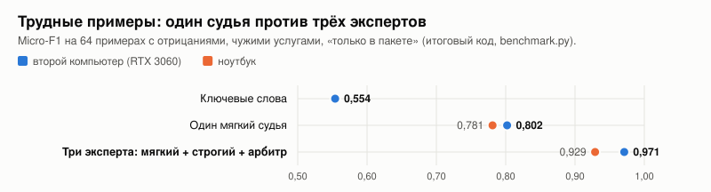
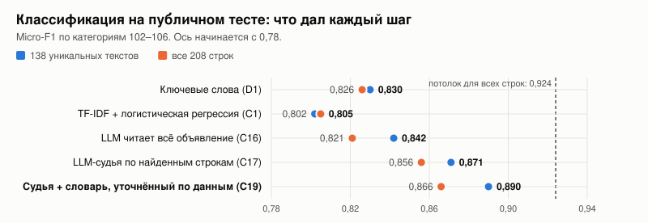

# Авито × Innoglobalhack: дополнительные микрокатегории и черновики объявлений

По тексту объявления о ремонте (исходная микрокатегория 101) решение находит услуги из микрокатегорий 102–106 — штукатурные работы, плитка, сантехника, электрика, малярные работы и обои — и для каждой предлагает черновик отдельного объявления. Ответ строго в формате организаторов: `{"drafts": [{"mcId": int, "title": str|null, "text": str|null}]}`.

Всё работает локально: один процесс на Python и одна открытая языковая модель (T-lite-it-2.1) в Ollama. Интернет и платные сервисы не нужны.

## Как это работает

1. **Поиск упоминаний.** Ключевые слова и TF-IDF находят строки, где названы работы пяти категорий. Если ничего не найдено, ответ пустой и модель не вызывается.
2. **Три эксперта.** Локальная LLM в трёх ролях решает, предлагает ли исполнитель работу как услугу: мягкий судья, строгий судья и арбитр, который вызывается только при их расхождении. Так отсекаются отрицания («электрику не делаем»), чужие услуги, состав бригады, «только под ключ».
3. **Черновик.** Та же модель пишет заголовок и текст из фрагментов исходника. Проверки без LLM ищут выдуманные числа, чужие услуги и новые слова; при нарушении — один повтор с замечаниями, затем шаблон из фраз исходника.

Подробно — в [docs/15_architecture.md](docs/15_architecture.md).

## Результаты

Micro-F1 по категориям 102–106.

| Вариант | 138 уникальных текстов публичного теста | Все 208 строк | Трудные примеры |
| --- | --- | --- | --- |
| Ключевые слова | 0,830 | 0,826 | 0,48 (16 примеров) |
| TF-IDF + логистическая регрессия | 0,802 | 0,805 | 0,53 (16) |
| LLM-судья по найденным строкам | 0,871 | 0,856 | 0,89 (16) |
| Судья + словарь, уточнённый по данным | 0,890 | 0,866 | 0,845 (59) |
| Один судья, итоговый код с правилами ментора | 0,840 | — | 0,802 (64) |
| **Три эксперта, итоговый код** | 0,826 | — | **0,971 (64)** |

- Потолок на 208 строках при одном ответе на текст — 0,924: одинаковые тексты в публичном тесте размечены по-разному.
- Черновики: 55 % проходят проверки сразу, ещё 30 % исправляются одним повтором, 15 % заменяются шаблоном (40 пар).
- На 64 трудных примерах три эксперта дают 62 точных ответа из 64, один судья — 48. На публичном тесте итоговая версия ниже прежней: правила эталона, названные ментором, расходятся с его разметкой.
- Время на RTX 3060: 3,2 секунды на объявление в среднем без черновиков и 8,3 секунды с черновиками от LLM (три эксперта); один вызов модели — около 2 секунд. На ноутбуке с RTX 2080 Super Max-Q вызов длится около 15 секунд.
- Расход: 3 446 токенов на входе и 288 на выходе на объявление с черновиками; электроэнергия — около 3 рублей на 1000 объявлений (оценка).





Все числа, графики и отклонённые идеи — в [docs/14_experiments_report.md](docs/14_experiments_report.md).

## Как запустить

Команды — из корня репозитория. В PowerShell один раз на окно:

```powershell
$env:PYTHONUTF8 = "1"; $env:PYTHONPATH = "src"
```

В bash те же переменные ставятся перед командой: `PYTHONUTF8=1 PYTHONPATH=src .venv/Scripts/python …` (на Linux — `.venv/bin/python`).

### 1. Окружение и модель

```powershell
uv venv --python 3.13; uv pip install -r requirements.txt
```

```powershell
ollama pull hf.co/t-tech/T-lite-it-2.1-GGUF:Q4_K_M
```

Ollama должен быть запущен (`ollama serve` или приложение в трее). Проверка окружения:

```powershell
.venv\Scripts\python scripts\check_env.py
```

### 2. Данные и быстрая модель

```powershell
.venv\Scripts\python scripts\prepare_data.py
```

Модель TF-IDF уже лежит в `artifacts/tfidf/`. Переобучить (несколько минут на процессоре):

```powershell
.venv\Scripts\python scripts\train.py
```

### 3. Ответ для файла с объявлениями

Вход — CSV со столбцами `testcase` и `description`. Выход — CSV в формате бота: `testcase,microcats,descriptions`.

```powershell
.venv\Scripts\python scripts\make_submission.py input.csv output.csv --judge-mode panel --drafts template --with-101
```

| Параметр | Значения |
| --- | --- |
| `--judge-mode` | `panel` — три эксперта; `single` — один судья, втрое быстрее |
| `--drafts` | `llm` — черновики пишет модель; `template` — шаблон без модели; `none` — только категории |
| `--with-101` | добавлять 101 в список категорий каждой строки |
| `--workers N` | считать N объявлений одновременно; нужен Ollama, запущенный с `OLLAMA_NUM_PARALLEL=N` |
| `--limit N` | только первые N строк, для проверки |

Прогресс пишется в `output.csv.jsonl`; прерванный запуск продолжается с места остановки той же командой.

Для файлов без столбца `testcase` (CSV, Parquet, JSONL со столбцом `description`) есть общий пакетный запуск с ответом в JSONL:

```powershell
.venv\Scripts\python scripts\predict_batch.py dataset\public\public-test-dataset.parquet out.jsonl --mode full
```

Режимы: `classify` — только категории, `full` — с черновиками от модели, `fast` — без модели (ключевые слова и шаблоны).

### Демо-интерфейс

Нужны запущенная Ollama с моделью из шага 1 и обученная быстрая модель из шага 2. В PowerShell:

```powershell
$env:PYTHONUTF8 = "1"; $env:PYTHONPATH = "src"
```

```powershell
.venv\Scripts\python app\server.py
```

Откройте http://127.0.0.1:7860. Вкладка «Файл» принимает CSV со столбцами `testcase,description`, показывает прогресс и позволяет скачать результат в формате для бота. Вкладка «Один текст» обрабатывает объявление, введённое вручную. Вкладка «Предыдущие отправки» хранит прошлые запуски. Подробности и решение проблем — в [app/README.md](app/README.md).

### 4. Оценка

Три эксперта на публичном тесте и трудных примерах; ответы сохраняются в `reports/judge_<метка>_<срез>.jsonl`:

```powershell
.venv\Scripts\python scripts\run_judge.py --tag myrun
```

Пересчитать метрики по сохранённым ответам, без вызовов модели:

```powershell
.venv\Scripts\python scripts\run_judge.py --tag myrun --cached
```

Оценить готовый файл предсказаний на срезе (`gold_raw`, `gold_consensus`, `silver_cv`, `challenge`):

```powershell
.venv\Scripts\python scripts\evaluate.py out.jsonl.bot.jsonl --slice gold_raw
```

Замеры для защиты — качество, время по этапам, токены, оценка стоимости — в `reports/benchmark.json`:

```powershell
.venv\Scripts\python scripts\benchmark.py --slice challenge --judge-mode panel single --drafts llm
```

Источник — срез с эталоном (`--slice challenge | gold_consensus | gold_raw`, считается и micro-F1) или любой CSV со столбцом `description` (`--input файл.csv`, только время и расход). `--drafts none` меряет одну классификацию, `--limit N` берёт первые N строк.

Эксперименты с черновиками:

```powershell
.venv\Scripts\python scripts\run_g23.py --variant c --exp G2,G3
```

### 5. Графики и тесты

```powershell
.venv\Scripts\python scripts\make_charts.py
```

```powershell
.venv\Scripts\python tests\test_core.py
```

`tests\test_format.py` проверяет формат ответа на всём публичном тесте; с включённым судьёй он делает сотни вызовов модели, поэтому для быстрой проверки поставьте в `configs/default.yaml` `judge.enabled: false`.

### Настройки

Всё в `configs/default.yaml`: модель и адрес Ollama (`llm`), режим судьи и подсказки (`judge`), параметры черновиков (`drafts`), режим по умолчанию (`mode`).

## Документы

| Файл | Содержание |
| --- | --- |
| [docs/13_backlog.md](docs/13_backlog.md) | Ход работы: этапы, принятые решения, отклонённые идеи, что не сделано |
| [docs/14_experiments_report.md](docs/14_experiments_report.md) | Эксперименты по порядку, с числами и графиками |
| [docs/15_architecture.md](docs/15_architecture.md) | Архитектура решения и выбор моделей |
| [docs/06_experiments.md](docs/06_experiments.md) | Полный реестр экспериментов |
| [docs/11_improvement_plan.md](docs/11_improvement_plan.md) | Разбор первых результатов и план улучшений |
| [docs/12_mentor_meeting_questions.md](docs/12_mentor_meeting_questions.md) | Вопросы к менторам |
| [docs/00_overview.md](docs/00_overview.md) | Исходный обзор данных и первоначальный план |
| [docs/01_spec_data_eval.md](docs/01_spec_data_eval.md) – [docs/04_spec_service_demo.md](docs/04_spec_service_demo.md) | Технические задания: данные и оценка, классификация, черновики, сервис |
| [docs/09_downloads.md](docs/09_downloads.md), [docs/10_sources.md](docs/10_sources.md) | Загрузки и источники |

Материалы организаторов — в `task/` и `dataset/public/`. Папки `scratch/` и `.nocommit/` в git не попадают.

## Что не сделано

- Результат бота на приватном наборе на момент записи неизвестен.
- Не выяснено, какая часть падения на публичном тесте вызвана правилами ментора, а какая — расширенным словарём.
- Демо-интерфейс (форма и загрузка CSV) в этой ветке не реализован, папка `app/` пуста.
- Ручная оценка качества черновиков не проводилась.

Полный список — в конце [docs/13_backlog.md](docs/13_backlog.md).
