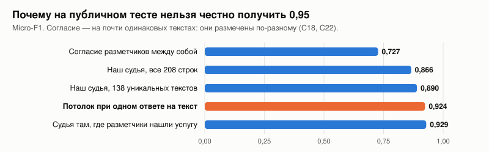
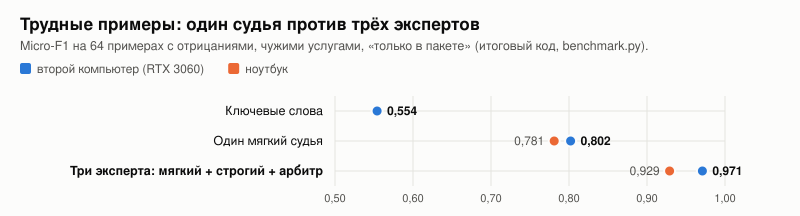
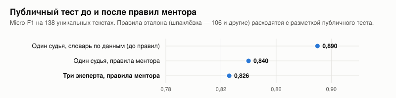
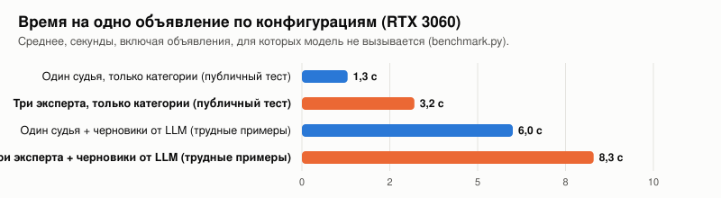

# Эксперименты и замеры: что пробовали, в каком порядке и что получилось

Отчёт по порядку, с числами. Полный реестр со всеми вариантами — [06_experiments.md](06_experiments.md), журнал прогонов — `reports/runs.jsonl`. Графики строятся командой `python scripts/make_charts.py` и лежат в `docs/img/`.

## Как мы меряем

Метрика — micro-F1 по пяти категориям 102–106, как `f1_score(average="micro")` в sklearn. Категория 101 в подсчёт не входит.

| Срез | Что это | Зачем |
| --- | --- | --- |
| Все строки | 208 строк публичного теста как есть | Сопоставимо с тем, что считают организаторы |
| Уникальные тексты | 138 уникальных текстов, метка — большинство голосов по повторам, спорные ячейки исключены | Убирает повторы с разными метками |
| Трудные примеры | Примеры, написанные нами: отрицания, чужие услуги, «только в пакете», опечатки. Сначала 16, потом 64 (40 для настройки, 24 отложенных) | Единственный срез без шума разметки |
| Трейн | 10 000 строк с автоматической разметкой, 4 839 уникальных текстов | Обучение простой модели и проверка словаря |

Доверительный интервал на публичном тесте широкий: для результата 0,890 это 0,83–0,94. Различия меньше 0,02 на нём — шум.

## 1. Простые модели

| Вариант | Уникальные тексты | Все строки | Трейн | Трудные (16) |
| --- | --- | --- | --- | --- |
| Правило по ключевым словам (D1) | 0,830 | 0,826 | 0,935 | 0,48 |
| TF-IDF по символьным n-граммам + логистическая регрессия (C1) | 0,802 | 0,805 | 0,923 | 0,53 |

Как работает правило: для каждой категории задан набор корней слов («штукатур», «плитк», «сантехни», «электр», «покраск» и так далее); если корень найден в тексте — категория ставится.

Вывод: модель, обученная на 10 000 примеров, не обогнала два десятка корней. Причина нашлась на следующем шаге.

## 2. Диагностика: почему результат не растёт

- **Полнота уже 98 %.** Ключевые слова пропускают 4 категории из 150. Все потери — лишние категории (56 штук).
- **Ручная разметка строже автоматической.** Если в объявлении есть корень категории, трейн ставит категорию в 91 % случаев, публичный тест — в 72 %. Модель, обученная на трейне, учит мягкое правило.
- **Ошибки сидят в немногих объявлениях.** 50 из 67 лишних категорий приходятся на 17 объявлений, где эталон пуст целиком.
- **Потолок.** Если бы мы безошибочно знали, нужны ли объявлению черновики вообще, получили бы 0,936 на уникальных текстах и 0,889 на всех строках (C14).
- **Статистика не помогает.** Число упоминаний, их положение, вероятность модели не отделяют пустые объявления от непустых: 0,80–0,82 (C15).

## 3. LLM-судья

Идея: ключевые слова находят строки с упоминанием работы, а локальная LLM решает, какую роль играет упоминание.

| Вариант | Уникальные тексты | Все строки | Трудные (16) | Лишних / пропущенных |
| --- | --- | --- | --- | --- |
| Ключевые слова | 0,830 | 0,826 | 0,48 | 56 / 4 |
| LLM читает объявление целиком (C16) | 0,842 | 0,821 | 0,80 | 17 / 24 |
| **LLM видит только найденные строки (C17)** | **0,871** | **0,856** | **0,89** | **38 / 5** |

Как работает судья:

1. Для каждой категории берётся до шести строк с её корнями, каждая с ближайшим заголовком блока. Добавляются первые 350 символов объявления и фразы об условиях («только комплексно», «отдельные работы не берём»).
2. Модель для каждой категории пишет причину в одну фразу и роль: услуга; только в пакете; состав бригады; контроль качества; пример выполненного объекта; отрицание или сравнение; другая сторона или материалы; предмет, а не работа; другое.
3. По умолчанию упоминание — услуга. Категория снимается, только если модель назвала конкретную причину.

Почему целое объявление хуже: в длинном тексте модель на 8 млрд параметров отвечает «не упомянуто» там, где работа стоит пунктом списка.

На входе судьи в среднем 1 030 токенов, на выходе 104. Повтор того же прогона даёт разброс около ±0,005.

## 4. Что пробовали поверх судьи

Все числа — уникальные тексты публичного теста; судья до изменений даёт 0,867–0,871.

| Идея | Результат | Вывод |
| --- | --- | --- |
| Модель T-lite Q5 вместо Q4 (C18) | 0,850 | не лучше |
| Модель Qwen3.5-9B (C18) | 0,856 | не лучше |
| Три модели, решение большинством (C20) | 0,866 | ошибки у моделей общие |
| Четыре ближайших размеченных объявления теста в подсказке (C21) | 0,853 | примеры противоречат друг другу |
| Решение по ближайшим объявлениям без LLM (C22) | 0,78–0,87 | та же причина |
| **Словарь корней, уточнённый по данным (C19)** | **0,890** | принят |

Словарь (C19): добавлены пропущенные формы («розеток», «кафель», «обои», «освещение»), убраны слабые корни. Правило по ключевым словам на трейне выросло с 0,935 до 0,951, пропусков стало 65 вместо 378.

## 5. Почему публичный тест больше ничего не показывает

Мы сравнили пары почти одинаковых объявлений теста (совпадение текста от 90 %, но не дословное). Если метки одного взять как ответ для другого, получится 0,727; в 22 % пар одно объявление размечено пустым, а другое — с категориями.

| Показатель | Значение |
| --- | --- |
| Согласие разметчиков на почти одинаковых текстах | 0,727 |
| Наш судья, все строки | 0,866 |
| Наш судья, уникальные тексты | 0,890 |
| Потолок на всех строках при одном ответе на текст | 0,924 |
| Наш судья на объявлениях, где разметчики нашли хоть одну услугу | 0,929 |

Вывод: выше 0,92 на 208 строках честно получить нельзя, а результаты выше 0,89 неотличимы друг от друга. Поэтому дальше мы настраивали решение на чистых трудных примерах, а не на публичном тесте.

## 6. Трудные примеры и три эксперта

Набор расширен до 59, затем до 64 примеров. Метки ставились только там, где ответ следует из правил организаторов; спорные случаи вынесены в `data/challenge/disputed_examples.jsonl` и в оценку не входят.

Что показал один судья (59 примеров, C23): 0,845, из них 16 лишних категорий и 6 пропущенных. Лишние — судья не замечает оговорку в той же строке («плитку не кладём», «электрику делают ваши мастера», дизайн-проект, уборка). Пропущенные — словарь не нашёл слово («заменю стояки», «сантехнка»).

| Вариант (59 примеров, разведка) | F1 | Лишних | Пропущенных |
| --- | --- | --- | --- |
| Ключевые слова | 0,565 | 89 | 5 |
| Мягкий судья (по умолчанию «услуга») | 0,845 | 16 | 6 |
| Мягкий судья, роль «другое» тоже снимает | 0,863 | 13 | 6 |
| Строгий судья (порядок проверки: отрицание → кто выполняет → что делают) (C24) | 0,807 | 2 | 20 |
| **Мягкий + строгий + арбитр при расхождении (C25)** | **0,894** | **7** | **7** |

Как работают три эксперта:

- Мягкий и строгий судьи получают один и тот же запрос с разными правилами. Мягкий оставляет лишнее, строгий снимает лишнее.
- Если они согласны — решение принято. Если разошлись — третий вызов, арбитр: один вопрос про одну работу, весь текст объявления (если он короче 1 800 символов), ответ «да» или «нет» с цитатой.
- Арбитр оказался прав в 19 случаях из 25.

На отложенной части (22 примера) три эксперта дали 0,917 против 0,885 у одного судьи.

После переноса в основной код и применения правил ментора на всех 64 примерах: три эксперта 0,971, один судья 0,802 (раздел 10).

## 7. Правила ментора и их цена

После второй встречи с ментором словарь и подсказки приведены к правилам эталона: шпаклёвка — всегда 106, откосы и выравнивание стен — 102, тёплый пол — сантехника или электрика по типу, заголовок не используется.

Эти правила расходятся с разметкой, которая у нас есть: в трейне шпаклёвка без других слов даёт категорию 102 в 96 % случаев, а категорию 106 — в 3 %. Правило по ключевым словам с новым словарём на публичном тесте упало с 0,842 до 0,821. Мы сознательно следуем ментору: приватный набор размечен по его правилам.

## 8. Черновики

Как работает: объявление режется на фрагменты и каждый помечается (целевая категория, чужая категория, общие условия); LLM получает правила и материал и возвращает заголовок и текст; шесть проверок без LLM ищут выдуманные числа, запрещённые фразы, чужие услуги, новые слова, низкое покрытие и нарушения формы; при нарушении — один повтор с замечаниями; если не помогло — шаблон из фраз исходника.

| Эксперимент | Прошли сразу | Исправлены повтором | Ушли в шаблон |
| --- | --- | --- | --- |
| G1: 192 пары, без перегенерации | 54,7 % | — | 48,4 % (включая пустые ответы сервера) |
| G3: 40 пар, без перегенерации | 55 % | — | 45 % |
| G3: 40 пар, с одной перегенерацией | 55 % | 30 % | 15 % |

Сравнение того, что давать модели (G2, 40 пар, с перегенерацией):

| На входе | Прошли сразу | Исправлены | В шаблон | Токенов на входе |
| --- | --- | --- | --- | --- |
| Только объявление | 37,5 % | 20 % | 42,5 % | 2 051 |
| Объявление + отобранные фрагменты | 55 % | 30 % | 15 % | 2 140 |
| Только фрагменты и общие условия | 62,5 % | 22,5 % | 15 % | 1 061 |

Главное нарушение — чужие услуги (16 из 19 в первом ответе). Модель их не выдумывает: слово всегда есть в исходнике, в строке, где категории перечислены вместе («разводка электрики и сантехники»). Вариант «только фрагменты» не зависит от длины объявления, поэтому он используется для приватного набора, где описания доходят до 72 000 символов.

Ручная оценка качества текста не проводилась: все числа выше — автоматические проверки.

## 9. Скорость и расход

| Замер | Ноутбук (RTX 2080 Super Max-Q, 8 ГБ) | Второй компьютер |
| --- | --- | --- |
| Один вызов судьи, медиана | 14,5–15,6 с | 2,0 с |
| Черновик без перегенерации, медиана | 16,5 с | 2,1 с |
| Черновик с перегенерацией, медиана | 21,4 с | 2,7 с |
| Классификация без LLM, 208 строк | 0,7 с | — |

- Токены: судья — 1 030 на входе и 104 на выходе; черновик — 1 435 и 108, с перегенерацией 2 140 и 152.
- Ноутбук медленный не из-за модели: видеокарта загружена на 99 %, но потребляет 27 Вт и выдаёт около 7 токенов в секунду; причина не выяснена.
- Приватный набор (262 объявления) с тремя экспертами и черновиками от LLM считался бы около 50 минут — 11 секунд на объявление. Один судья без черновиков — около 1,3 секунды на объявление в среднем на RTX 3060 (раздел 10).
- Объявления без ключевых слов модель не вызывают: на публичном тесте это половина набора.

## 10. Итоговые замеры (`scripts/benchmark.py`)

Итоговый код: три эксперта, правила ментора, заголовок не используется. Второй компьютер — RTX 3060 12 ГБ, ноутбук — RTX 2080 Super Max-Q 8 ГБ. Файлы: `reports/benchmark_challenge_full.json`, `reports/benchmark_gold.json`, `reports/benchmark_challenge.json`.

### Качество

| Срез | Конфигурация | Micro-F1 | Доверительный интервал | Лишних | Пропущенных | Точно |
| --- | --- | --- | --- | --- | --- | --- |
| 64 трудных примера, RTX 3060 | Три эксперта | 0,971 | 0,92–1,00 | 4 | 0 | 62 из 64 |
| 64 трудных примера, RTX 3060 | Один судья | 0,802 | 0,70–0,89 | 33 | 0 | 48 из 64 |
| 64 трудных примера, ноутбук | Три эксперта | 0,929 | 0,85–0,99 | 8 | 2 | 59 из 64 |
| 64 трудных примера, ноутбук | Один судья | 0,781 | 0,67–0,88 | 36 | 1 | 47 из 64 |
| Отложенная часть (24), RTX 3060 | Три эксперта / один судья | 0,964 / 0,818 | — | 2 / 12 | 0 / 0 | 23 / 17 из 24 |
| 138 уникальных текстов публичного теста | Три эксперта | 0,826 | 0,75–0,89 | 52 | 8 | 108 из 138 |
| 138 уникальных текстов публичного теста | Один судья | 0,840 | 0,77–0,90 | 53 | 3 | 109 из 138 |

- На трудных примерах три эксперта убирают почти все лишние категории и не теряют верных. Выигрыш виден на обеих машинах и на отложенной части.
- На публичном тесте итоговая версия ниже прежних 0,871–0,890, и три эксперта не лучше одного. Причины две, и по этим замерам они не разделены: правила ментора расходятся с разметкой публичного теста; словарь расширен словами из справочника (тёплый пол, отопление, щиток), что добавляет кандидатов.
- Одна и та же модель на двух машинах отвечает по-разному: 0,929 против 0,971 при одинаковых запросах.

### Время и расход (RTX 3060)

| Показатель | Три эксперта | Один судья |
| --- | --- | --- |
| Только категории, секунд на объявление: медиана / среднее / 95-й перцентиль (публичный тест) | 1,7 / 3,2 / 8,8 | 0,8 / 1,3 / 4,0 |
| С черновиками от LLM, секунд на объявление: медиана / среднее / 95-й перцентиль (трудные примеры) | 6,0 / 8,3 / 13,9 | 4,5 / 6,0 / 13,1 |
| Объявлений в минуту с черновиками | 7,2 | 10,0 |
| Вызовов судьи на объявление (публичный тест) | 1,33 | 0,52 |
| Доля объявлений, для которых модель вызывается (публичный тест) | 52 % | 52 % |
| Токенов на объявление, только категории (вход / выход) | 1 591 / 124 | 636 / 58 |
| Токенов на объявление, с черновиками (вход / выход) | 3 446 / 288 | 2 549 / 208 |

Один вызов, медиана: мягкий судья 2,0 с (1 023 токена на входе, 101 на выходе), строгий 1,9 с (1 226 и 97), арбитр 1,7 с (578 и 48), черновик 1,6 с (988 и 74; в среднем 1,58 вызова на черновик).

Железо: модель выдаёт 40 токенов в секунду при 169 Вт и занимает до 7,8 ГБ видеопамяти. На ноутбуке — 6 токенов в секунду при 22 Вт, вызов судьи длится 14,5 с; три эксперта без черновиков — 32 с на объявление.

Оценка стоимости на 1000 объявлений с черновиками (три эксперта): электроэнергия — 2,7 руб. при тарифе 7 руб. за кВт·ч (учтена только видеокарта); аренда видеокарты — 138 руб. при 60 руб. в час. Тариф и цена аренды — допущения, а не измерения.

Черновики на трудных примерах: 71 штука, 42 % прошли проверки сразу, 17 % исправлены повтором, 41 % заменены шаблоном. Это хуже, чем на объявлениях публичного теста (15 % шаблонов): трудные примеры короткие, и категории в них названы в одной строке.

## 11. Как собраны наборы данных

Все таблицы строит `scripts/prepare_data.py` (код — `src/avito_drafts/data.py`) в `data/processed/`.

| Набор | Источник | Как получен | Размер |
| --- | --- | --- | --- |
| Трейн (`silver`) | `dataset/public/public-train-annotated.jsonl`, разметка автоматическая | Текст нормализуется; строки с одинаковым нормализованным текстом склеиваются; близкие тексты (косинусная близость TF-IDF от 0,8) объединяются в группы; пять частей для перекрёстной проверки режутся по группам, чтобы почти одинаковые тексты не попадали и в обучение, и в проверку | 10 000 строк, 4 839 уникальных текстов, 3 188 групп |
| Все строки теста (`gold_raw`) | `dataset/public/public-test-dataset.parquet`, разметка ручная | Как есть | 208 строк |
| Уникальные тексты теста (`gold_consensus`) | Тот же файл | Строки с одинаковым текстом объединяются; метка каждой категории — большинство голосов; при равенстве голосов ячейка исключается из подсчёта | 138 текстов; 27 групп повторов, 13 из них с противоречиями; 11 исключённых ячеек |
| Трудные примеры (`challenge`) | `data/challenge/seed_examples.jsonl`, написаны нами | По одному-двум примерам на явление: отрицание, чужая сторона, «только в пакете», состав бригады, пример объекта, непривычные слова, опечатки, подмена букв. Метка ставилась, только если ответ следует из правил организаторов. Примеры поделены на часть для настройки подсказок и отложенную | 64 примера: 40 и 24 |
| Спорные случаи | `data/challenge/disputed_examples.jsonl` | Примеры, ответ на которые зависит от организаторов (отопление, демонтаж, перечень этапов). В оценку не входят | 5 |
| Приватный набор | Файл организаторов, в репозиторий не входит | Только идентификатор и описание, без заголовка и без меток | 262 объявления |

Нормализация текста (`text.py`): латинские буквы, подставленные вместо похожих кириллических, заменяются обратно (такая подмена есть в 2,4–2,9 % объявлений), текст приводится к нижнему регистру, лишние пробелы убираются. 48 групп трейна содержат тексты, близкие к публичному тесту; они помечены, чтобы не использовать их в проверке.

Выборка для экспериментов с черновиками (`reports/g_sample.json`): 40 пар «объявление, категория» из публичного теста, по 8 на категорию, фиксированное зерно.

## 12. Как всё проверялось

- **Одна метрика, один инструмент.** Любой вариант оценивается функцией `evalkit.evaluate`: micro-F1 через sklearn, лишние и пропущенные категории, доля пустых ответов. Каждый прогон дописывается в `reports/runs.jsonl` с меткой эксперимента и отпечатком конфигурации.
- **Доверительные интервалы.** Бутстреп по группам текстов (а не по строкам), 95 %. Различия меньше ширины интервала мы не считаем выигрышем.
- **Два среза публичного теста.** Результат называется и для всех 208 строк, и для 138 уникальных текстов.
- **Отложенная часть.** Подсказки судей настраивались на 40 трудных примерах; 24 отложенных использовались только для проверки.
- **Повторяемость.** Ключевые прогоны повторены на двух машинах; разброс от прогона к прогону на публичном тесте — около ±0,005, между машинами на трудных примерах — до 0,04.
- **Ответы модели сохраняются.** Роли, причины и цитаты экспертов лежат в `reports/judge_*.jsonl`; метрики пересчитываются без вызовов модели (`run_judge.py --cached`), а ошибки можно разобрать по причинам.
- **Защита от подгонки.** Идеи, использующие публичный тест как источник знаний (примеры в подсказке, перенос меток), оценивались с исключением самого объявления и его почти-повторов.
- **Формат ответа.** `tests/test_format.py` проверяет схему ответа на всех строках публичного теста и трудных примерах; `tests/test_core.py` — нормализацию, словарь, шаблон и проверки черновиков. С включённым судьёй тест формата не запускался.
- **Черновики** проверяются только автоматически (шесть проверок без LLM). Ручной оценки качества текста не было.
- **Что осталось непроверенным:** результат на приватном наборе; вклад расширенного словаря в падение на публичном тесте; качество черновиков глазами человека.

## 13. Как устроен замер (`scripts/benchmark.py`)

1. **Вход.** Срез с эталоном (`challenge`, `gold_consensus`, `gold_raw`) или любой CSV со столбцом `description`. Для каждой конфигурации (`panel`, `single`) создаётся свой экземпляр решения, поэтому конфигурации не делят между собой сохранённые ответы.
2. **Прогон.** Объявления обрабатываются по одному, в один поток, тем же кодом, что и в рабочем режиме (`Predictor.predict_batch`). Точные повторы текста считаются один раз.
3. **Время.** Для каждого объявления меряется полное время от входа до ответа; отдельно берётся время каждого вызова модели, которое сообщает сам сервер. Сводка — медиана, среднее и 95-й перцентиль. В среднее входят и объявления, для которых модель не вызывалась.
4. **Расход.** Число вызовов и токены на входе и выходе берутся из ответов сервера по каждому этапу: мягкий судья, строгий судья, арбитр, черновик. Скорость — токены на выходе, делённые на время вызовов.
5. **Качество.** Ответы сравниваются с эталоном той же функцией, что и во всех экспериментах: micro-F1, лишние и пропущенные категории, точно угаданные объявления, доверительный интервал бутстрепом. Для трудных примеров — отдельно настроечная и отложенная части.
6. **Железо.** Каждые десять объявлений опрашивается `nvidia-smi`: занятая видеопамять (берётся максимум) и потребляемая мощность (берётся среднее).
7. **Стоимость.** Электроэнергия = средняя мощность видеокарты × время × тариф; аренда = время × цена часа. Тариф и цена — параметры запуска, результат помечен как оценка.

Ограничения замера: один поток (параллельные запросы не мерились); первое объявление включает загрузку модели в память; мощность учитывает только видеокарту; при `--limit` качество не считается.

## Известные особенности сервера моделей

- Если запрос заканчивается переводом строки, вывод по JSON-схеме часто пуст (4 из 5 вызовов). Запрос должен заканчиваться явной фразой «Ответь строго в формате JSON…» — тогда пустых ответов 0 из 84.
- T-lite Q5 и Qwen3.5 в Ollama кладут ответ в поле «рассуждения»; им нужен параметр `think: false`, иначе ответ считается пустым.
- Первый вызов после запуска сервера однажды завис на 14 минут и вернул пустой ответ. В этом случае код отдаёт ответ по ключевым словам с пометкой.
