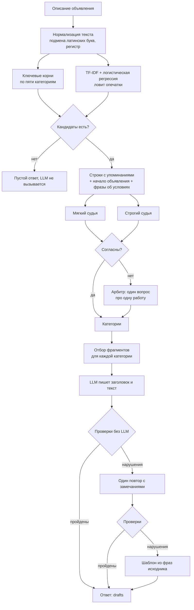

# Архитектура решения и выбор моделей

Как устроено решение в текущей ветке. История и причины решений — [13_backlog.md](13_backlog.md), числа — [14_experiments_report.md](14_experiments_report.md).

## В одном абзаце

Один процесс на Python и одна локальная языковая модель в Ollama. Ключевые слова и TF-IDF находят в объявлении упоминания работ; локальная LLM в трёх ролях (мягкий судья, строгий судья, арбитр) решает, предлагает ли исполнитель эту работу как услугу; та же LLM пишет черновик, а проверки без LLM отлавливают выдумки и при необходимости заменяют черновик шаблоном. Интернет и платные сервисы не нужны.

## Схема



## Классификация

### Шаг 1. Кандидаты (без LLM)

- **Ключевые корни** (`keywords.py`): для каждой категории — набор корней слов, сверенный со справочником категорий организаторов и ответами ментора. Заголовок не используется, только описание.
- **TF-IDF + логистическая регрессия** (`layer1.py`): символьные n-граммы длиной 2–5, обучена на трейне. Категория без корня становится кандидатом, если вероятность не ниже 0,5. Назначение — опечатки («сантехнка», «електрика»), которые корни не ловят.
- Если кандидатов нет, ответ пустой и модель не вызывается.

### Шаг 2. Три эксперта (`judge.py`, режим `panel`)

Все трое — одна и та же модель с разными системными подсказками.

| Эксперт | Подсказка | Что видит | Склонность |
| --- | --- | --- | --- |
| Мягкий судья | `prompts/judge_system.md` | Начало объявления, фразы об условиях, до шести строк на категорию | По умолчанию «услуга»; оставляет лишнее |
| Строгий судья | `prompts/judge_strict.md` | То же | Проверяет по порядку: отрицание, кто выполняет, что именно делают; снимает лишнее |
| Арбитр | `prompts/judge_arbiter.md` | Весь текст, если он короче 1 800 символов, иначе строки категории | Отвечает «да» или «нет» про одну работу, с цитатой |

Правило решения: если мягкий и строгий согласны — их решение; если разошлись — решает арбитр. Каждый судья для каждой категории пишет причину и роль упоминания (услуга, только в пакете, состав бригады, контроль качества, пример объекта, отрицание или сравнение, другая сторона или материалы, предмет, другое). Причины и цитаты сохраняются в служебных сведениях — их можно показать в демо как объяснение.

Режим `single` оставляет одного мягкого судью: втрое меньше вызовов.

### Что происходит при сбоях

| Сбой | Поведение |
| --- | --- |
| Модель недоступна или мягкий судья вернул пустой ответ | Ответ по ключевым корням, пометка `keywords_fallback` |
| Упал строгий судья | Решение мягкого |
| Упал арбитр | Решение мягкого |
| Модель слоя 1 не загрузилась | Кандидаты только по корням |

### Правила, зашитые в подсказки

По указаниям ментора и справочнику категорий: шпаклёвка — всегда 106; штукатурка, выравнивание стен, откосы — 102; «штукатурка под покраску» — только 102; тёплый пол водяной — 104, электрический — 105; услуга, доступная только в составе ремонта «под ключ», категорию не даёт; перечень работ в объявлении без запрета отдельных заказов считается услугами (решение команды).

## Черновики (`drafts/`)

1. **Отбор фрагментов** (`fragments.py`): объявление режется на строки и предложения; каждая часть помечается — целевая категория, чужая категория, общие условия, прочее.
2. **Генерация** (`pipeline.py`): один вызов на категорию, ответ по JSON-схеме с полями `title` и `text`. Три варианта входа: только объявление, объявление и фрагменты, только фрагменты.
3. **Проверки** (`checks.py`), без LLM: числа есть в исходнике; нет запрещённых формулировок; нет чужих услуг; мало новых слов; покрытие фрагментов; длины и отсутствие контактов.
4. **Исправление**: один повтор с перечнем нарушений при температуре 0,1; затем шаблон (`template.py`) — название услуги, список фраз исходника о ней и общие условия. Шаблон не выдумывает по построению.

## Выбор моделей

### Языковая модель: T-lite-it-2.1, квантование Q4_K_M

Требования задавали рамку: открытая модель, локальный запуск без платных сервисов, видеокарта 8 ГБ, русский язык, ответ строго по схеме.

| Причина | Подробности |
| --- | --- |
| Русский язык | Модель дообучена на русском (Т-Банк), у неё опубликованы русские оценки по каждому квантованию |
| Размер | 8 млрд параметров, файл 5,03 ГБ — помещается в 8 ГБ видеопамяти вместе с контекстом 4 096 токенов |
| Лицензия | Apache-2.0 |
| Ответ по схеме | Через Ollama модель отдаёт JSON по заданной схеме; в квантовании Q4 ответ приходит сразу, без отдельного поля рассуждений |
| Одна модель на всё | Судья, арбитр и генератор — один файл в памяти, без переключений |

Сравнение на нашей задаче (C18, судья, второй компьютер, ошибок вызова нет):

| Модель | Уникальные тексты | Все строки | Трудные (16) | Секунд на объявление |
| --- | --- | --- | --- | --- |
| **T-lite-it-2.1 Q4_K_M** | **0,867** | **0,855** | **0,923** | 2,0 |
| T-lite-it-2.1 Q5_K_M | 0,850 | 0,846 | 0,857 | 1,9 |
| Qwen3.5-9B Q4_K_M | 0,856 | 0,851 | 0,846 | 3,0 |

По карточке модели Q5 заметно сильнее Q4 на общих оценках, но на нашей задаче этого не видно: Q4 не хуже ни на одном срезе. Различия на публичном тесте лежат внутри доверительного интервала, поэтому вывод скромный: менять модель незачем. Голосование трёх моделей тоже ничего не дало (0,866).

Какие модели рассматривались. Языковые: T-lite-it-2.1 (Q4 и Q5) и Qwen3.5-9B — измерены; Gemma 4 E4B была в списке запасных, не запускалась. Энкодеры для дообучения: BERTA (основной кандидат), USER2-base, rubert-mini-frida — не запускались, причина ниже. Быстрая модель: TF-IDF с логистической регрессией — обучена и используется.

Время работы на RTX 3060: вызов судьи — 2,0 с, арбитра — 1,7 с, черновика — 1,6 с; модель выдаёт 40 токенов в секунду и занимает до 7,8 ГБ видеопамяти. На ноутбуке (8 ГБ, 22 Вт под нагрузкой) — 6 токенов в секунду. Подробно — раздел 10 отчёта.

Чего мы не проверяли: более крупные модели (14 млрд параметров и больше) и качество текста черновиков у других моделей.

### Быстрая модель: TF-IDF + логистическая регрессия

Символьные n-граммы устойчивы к опечаткам и подмене букв, обучение занимает минуты на процессоре, вывод — миллисекунды. На трейне при перекрёстной проверке 0,923, на публичном тесте 0,805. Как основной классификатор она проигрывает ключевым словам, поэтому её роль — второй источник кандидатов и вероятности в служебных сведениях.

### Что не взяли

| Вариант | Почему |
| --- | --- |
| Дообучение энкодера (BERTA) на метках трейна | Трейн размечен мягче ручной разметки; модель выучила бы мягкое правило. Отложено, не запускалось |
| LLM как единственный классификатор по всему тексту | Проверено: теряет упоминания в длинных объявлениях (24 пропуска против 4) |
| Облачные модели | Требование организаторов и ментора: локально, без платных сервисов |
| Очереди, несколько сервисов, Docker | Ментор просил простоту; Docker не нужен |

## Формат ответа

Единая функция (`predict.py`) возвращает строго:

```json
{"drafts": [{"mcId": 104, "title": "…", "text": "…"}]}
```

Не больше одного элемента на категорию, `mcId` от 102 до 106, по возрастанию. Рядом отдаются служебные сведения: источник решения, роли и причины экспертов, ответы арбитра, время и токены по этапам.

Режимы: `classify` — только категории; `full` — с черновиками от LLM; `fast` — ключевые слова и шаблонные черновики, без LLM.

## Где что лежит

| Путь | Содержание |
| --- | --- |
| `src/avito_drafts/keywords.py` | Словарь корней |
| `src/avito_drafts/layer1.py` | TF-IDF и логистическая регрессия |
| `src/avito_drafts/judge.py` | Три эксперта |
| `src/avito_drafts/llm.py` | Клиент Ollama с повторами |
| `src/avito_drafts/predict.py` | Единая функция предсказания |
| `src/avito_drafts/drafts/` | Фрагменты, генерация, проверки, шаблон |
| `src/avito_drafts/evalkit.py`, `data.py` | Срезы, метрики, подготовка таблиц |
| `prompts/` | Подсказки судей, арбитра и генератора |
| `configs/default.yaml` | Все настройки: модель, пороги, режимы |
| `data/challenge/` | Трудные примеры и спорные случаи |
| `scripts/` | Запуск: подготовка, обучение, оценка, отправка, графики |
| `reports/` | Журнал прогонов и ответы судей |

## Ограничения

- На 64 трудных примерах три эксперта дают 0,971 против 0,802 у одного судьи; на публичном тесте — 0,826 против 0,840, то есть выигрыша там нет. Публичный тест размечен не по тем правилам, которые назвал ментор.
- Подсказки судей настраивались на 40 трудных примерах; отложенных всего 24.
- Словарь не знает слов, которых нет ни в справочнике, ни в данных («заменю стояки» добавлено, но подобные формулировки возможны).
- Чужие услуги в черновиках появляются из строк, где категории перечислены вместе; такие строки пока не разрезаются.
- Демо-интерфейс в этой ветке не реализован.
